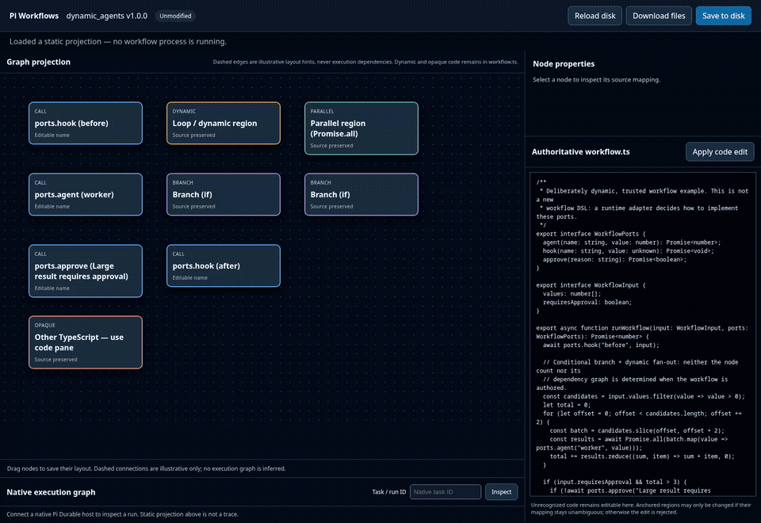
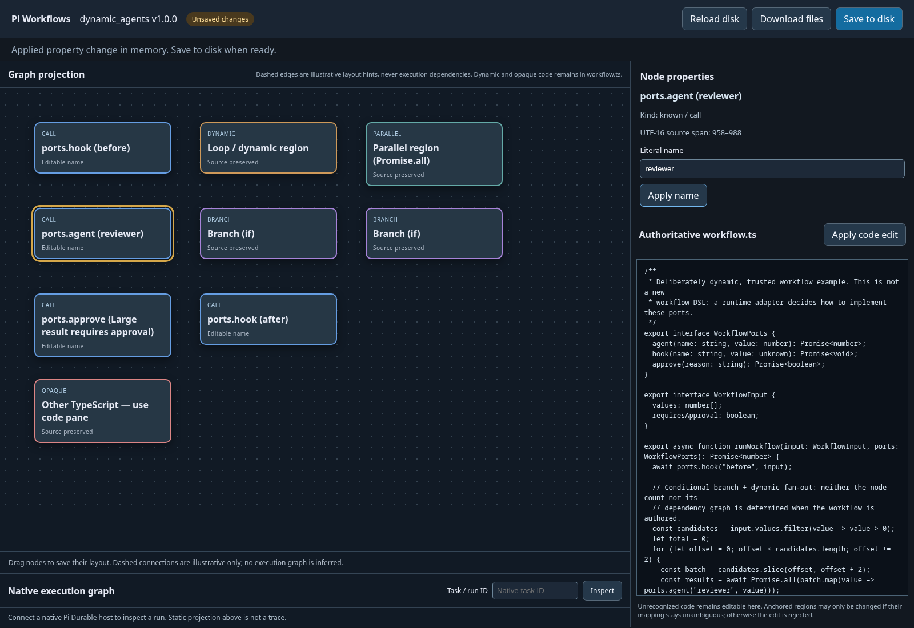

# pi-workflows

A code-first workflow workbench for [Pi](https://pi.dev/). Start from trusted TypeScript, inspect its static graph projection, and make safe edits without losing the code the graph cannot represent.

[](docs/assets/workflow-builder-walkthrough.webm)

[Watch the WebM video](docs/assets/workflow-builder-walkthrough.webm) · [Builder overview screenshot](docs/assets/workflow-builder-overview.png) · [Safe edit screenshot](docs/assets/workflow-builder-safe-edit.png)

## Quick start: open the builder

**You’ll need Node.js 22.19 or newer and npm.** From a terminal:

```sh
git clone https://github.com/mhingston/pi-workflows.git
cd pi-workflows
npm install --ignore-scripts
npm run editor -- --workflow ./fixtures/complex
```

Open **http://localhost:4175** in your browser. The example package is `dynamic_agents`; the editor loads its TypeScript and shows a static projection without starting a workflow. Stop the local server with `Ctrl+C` when you’re done.

## Make a safe first edit

1. Select the **ports.agent (worker)** node in the graph.
2. In **Node properties**, change **Literal name** to `reviewer` and choose **Apply name**.
3. Check that the selected node and `workflow.ts` now show `reviewer`. The header marks the change as **Unsaved changes**.
4. Choose **Save to disk** to keep the edit in the selected workflow directory. Choose **Reload disk** to discard staged edits and restore the files from disk.

Only the recognized string literal is changed by this graph property. The code pane remains available for source edits; the editor validates TypeScript and rejects edits when a source mapping can’t be matched safely.



## Reading the graph

- **Blue call nodes** represent recognized `ports.hook`, `ports.agent`, or `ports.approve` calls. Only a string-literal name on a recognized call is editable as a node property.
- **Branch, parallel, and dynamic nodes** show structures found in the source. Loops, branches, and fan-out are not rewritten through graph operations.
- **Opaque nodes** stand for code the graph does not model. The complete TypeScript stays authoritative in the source pane.
- **Dashed connections are layout hints.** They do not describe runtime dependencies or a native task graph.
- **The Native execution graph panel** is a separate, read-only view. It needs an embedding process connected to the owning Pi Durable host; the standalone editor does not run or attach to a workflow.

The editor is a local development tool bound to loopback. Loading the builder runs no workflow task, model call, or trusted module. It does not execute arbitrary TypeScript from the browser, and it is not an authenticated hosted service.

## What works today

- A browser-based static graph viewer/editor for a conservative TypeScript AST subset.
- Source-aware edits for recognized literal call names, editable TypeScript, and layout changes staged until save.
- Regular Pi `/workflow` commands and the `run_workflow` tool as entry points to the same workflow artifact.
- Native Pi Durable integration for the pinned, trusted `dynamic_agents` fixture. Regular Pi invocation is not crash-resumable.

Only trusted registered workflow modules are executable today. The visual editor does not execute arbitrary imported source. See the guides below for the supported runtime behavior and limitations.

## Choose your next step

| If you want to… | Read… |
| --- | --- |
| Understand editor behavior, safe edits, and limits | [Visual editor guide](docs/visual-editor.md) |
| Learn the `workflow.ts` / manifest / layout package | [Artifact format](docs/artifact-format.md) |
| Invoke a workflow from regular Pi | [Regular Pi commands and tool](docs/regular-pi-invocation.md) |
| Understand native tasks, checkpoints, and recovery | [Pi Durable execution](docs/durable-runtime.md) |
| Inspect run IDs and native task hierarchy | [Run correlation](docs/run-correlation.md) |
| Review providers and immutable publishing | [Provider contracts and publishing](docs/provider-publishing.md) |
| Follow the end-to-end evidence and release gate | [Integration gate](docs/integration-gate.md) |

## Verify changes

With dependencies installed, run the relevant checks:

```sh
npm run typecheck
npm run test:artifact
npm run test:durable
npm run test:invocation
npm run test:editor
npm run test:gate
npm run test:correlation
npm run test:providers
```

## Project scope

This project is independent of the similarly named [osolmaz/pi-workflows](https://github.com/osolmaz/pi-workflows). For the architecture and current design decisions, see the [implementation handoff](docs/HANDOFF.md).
